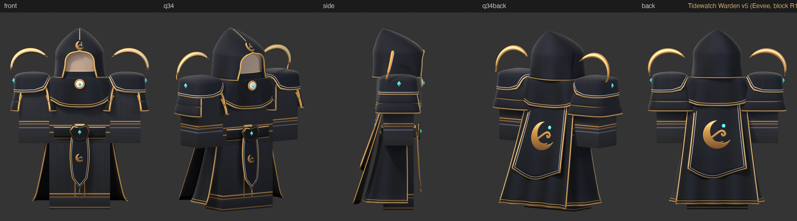
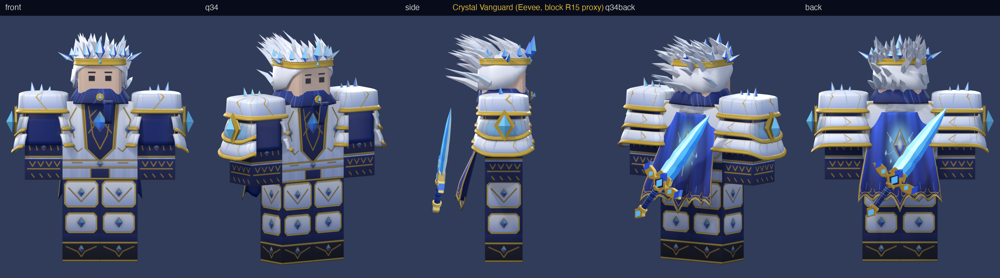

# roblox-gen

Help creators, and the AI agents that work for them, **generate Roblox content**: avatar clothing, 3D accessories
and experiences. The repo is both a human guide and an agent skill: point an AI coding agent at it and it
can reproduce the default example, then make your own set.



*Default example: "Tidewatch Warden", an original hooded outfit (classic shirt + pants, hood, mantle, cape, shoulder
plates, belt, skirt). Rendered on a block R15 proxy in Blender.*



*Second set: Crystal Vanguard (r10): swept mane, long flared cape, emissive crystals, face decal; built by Sonnet/Haiku, refined by Opus from the same repo.*

## What you can generate
| Output | How | Status |
|---|---|---|
| Classic shirt / pants (585x559 PNG) | Python painting on the official template UVs | works, tested in Studio |
| 3D accessories (hat, back, shoulder, waist) | Blender headless -> FBX -> Open Cloud upload -> worn in Studio | works, tested in Studio |
| Rigid hair, face decal (display), emissive glow | Blender strands, painted decal, SurfaceAppearance emissive masks | works, tested in Studio (Crystal Vanguard r10) |
| Layered clothing (cages) | not done yet | open |
| Experiences (places, scripts) | Luau built in Studio through the Studio MCP | first one: `experiences/showroom/` (try-on showroom), tested in Play |
| Marketplace pre-check | `docs/studio/ugc_check.lua` + `docs/MARKETPLACE_RULES.md` | local check of the documented limits; the official validator is the paid upload flow |

## Prerequisites
1. **Roblox account** and **Roblox Studio** (create.roblox.com), for testing before you pay anything.
2. **Open Cloud API key** with Assets read+write (create.roblox.com/dashboard/credentials) and your **numeric** user id.
   Put both in `~/.config/tidewatch/.env` (see `.env.example`). Never commit it.
3. **Blender 4.2 or newer** (free, tested with 4.5), run headless (`blender -b -P script.py`; on macOS `blender` = `/Applications/Blender.app/Contents/MacOS/Blender`).
4. **Python 3** with `pillow` and `numpy`.
5. Optional: an AI coding agent (Claude Code, Codex, ...).

Headless Linux: see `docs/LINUX_HEADLESS.md`. Needs Blender 4.2 or newer. Check everything (run from the repo root): `python3 scripts/check_prereqs.py`

The API key is only needed to **upload**. Generating and rendering the outfit locally needs only Blender and Python.
The key file path `~/.config/tidewatch/.env` is outside the repo on purpose (the folder name is historical, create it with `mkdir -p ~/.config/tidewatch`).

## Starter sets
- `examples/tidewatch-warden/`: finished default example.
- `examples/crystal-vanguard/`: the set below, r27 (physical-space painted textures with AO like Tidewatch; passes the Marketplace size/triangle/watertight pre-check at all body scales; history and weak points in its NOTES.md, Studio results in STUDIO_TEST.md, r10).
- `lib/`: shared code both examples import (`rgen_mesh.py` Builder/swatches/body proxy, `rgen_clothing.py` Face painter).
- `experiences/`: places and scripts (stage 4).
- `starter/ember-warden/` (cold Sonnet build, Studio-tested) and `starter/thornwood-druid/` (cold Haiku build, below the bar): full sets with textures, see `starter/README.md`.
- `starter/crystal-vanguard/`: concept art, prompts, sword blockout GLB and an exact spec for a second set. Agents: build it with `skills/roblox-2d-concept` (2D first) then `skills/roblox-avatar-fashion` (3D). See `docs/PIPELINE.md`.

## For AI agents
Read [`AGENTS.md`](AGENTS.md), then [`skills/roblox-avatar-fashion/SKILL.md`](skills/roblox-avatar-fashion/SKILL.md).
For Claude Code, install the skill with:
```bash
cp -R skills/roblox-avatar-fashion ~/.claude/skills/
```
Then ask: *"Generate the default Tidewatch Warden set and show me the render sheet."*

## Run the default example
One command (from the repo root; ~10 min, or ~3 min with `NOBAKE=1`, which skips the AO bakes):
```bash
examples/tidewatch-warden/run_all.sh r4          # -> examples/tidewatch-warden/out/v5/r4_sheet.png
examples/crystal-vanguard/run_all.sh r27         # second set, ~1 min (AO bakes ~4 s; NOBAKE=1 skips them) -> examples/crystal-vanguard/out/r27_sheet.png
```
Both scripts use `blender` on PATH, else the macOS app; override with `BLENDER=/path/to/blender`. Building the shipped
Crystal Vanguard rewrites its tracked release files (FBX headers carry a timestamp): `git checkout -- examples/crystal-vanguard` if you only wanted to look. Step by step:
All commands run from `examples/tidewatch-warden/` (after the repo-root prerequisites check). On Linux/Windows use the `blender` on your PATH instead of the macOS path; flags after `--` are `key=value` pairs.
```bash
# macOS: use /Applications/Blender.app/Contents/MacOS/Blender where it says blender
cd examples/tidewatch-warden
python3 make_clothing_v5.py
blender -b -P build_v5.py
python3 paint_v5.py
blender -b out/v5/v5_build.blend -P render_v5.py -- tag=r4 export=1
python3 compose_v5.py r4          # writes out/v5/r4_sheet.png (the render sheet)
```
Outputs land in `out/v5/`: `<tag>_sheet.png`, `tidewatch_shirt_v5.png`, `tidewatch_pants_v5.png`, one `.fbx` per accessory. Optional (normally unset, skip it): if `ROBLOX_GEN_REFERENCE` is set, a private `<tag>_vs_reference.png` is also written: never commit or ship it.

Upload privately and test in Studio (needs the key): `SSL_CERT_FILE=/etc/ssl/cert.pem python3 ../../scripts/upload_assets.py out/v5/*.fbx out/v5/*.png`.
Details, measurements and every trap found are in the skill file.

## Make your own set
Fast path (recommended, ~1 min per build). Example: a set called "Ember Sentinel" in `examples/ember-sentinel/`.
1. **Copy** `examples/crystal-vanguard/` to `examples/<your-set>/` (keep it two levels deep: scripts import `../../lib`
   and the sword reads `../../starter/crystal-vanguard/3d/*.glb`; a set without that sword replaces `build_sword()` and the GLB load). In the copy **delete** the old release files and notes:
   `*.fbx`, `crystal_vanguard_*.png`, `render_sheet.png`, `2d_preview.png`, `NOTES.md`, `STUDIO_TEST.md`, `out/`.
   `run_all.sh` regenerates the release files under your names. The script/object names (`*_cv.py`, `cv_*` objects, swatch
   names like `sapphire`) stay as they are by design; only `palette.py` names reach the outputs.
2. **Colours + names: `palette.py` only.** `SET_NAME`, `NAMES` (FBX files, shirt/pants/face PNGs) and `THEME` (hue shift,
   saturation and value multipliers for four families: metal, plate, cloth, crystal). Read its docstring first: it lists the
   authored hues, which colour lands in which family (the bright cape is "crystal", not "cloth") and two tested themes.
3. **Shapes / emblem** (optional): `build_cv.py` (one `build_*()` per accessory, API in `docs/BUILDER_CHEATSHEET.md`) and the
   emblem drawing in `paint_cv.py` (`cape()`). Keep swatch names (`gold`, `crystal`, ...) stable: `build_cv.py` refers to them.
   **New items or new shapes** touch these together (a cold Sonnet built "Ember Warden" this way on 2026-11-09):
   `build_*()` + the `__main__` item list in `build_cv.py`; the painter for its UV regions in `paint_cv.py` (+ emissive mask);
   `ITEMS`, `ATT` (attachment offset) and `LIMITS` (size box, `docs/MARKETPLACE_RULES.md`) in `render_cv.py`; `NAMES` in
   `palette.py`; the wear script rows. Lay out UVs with `iso_rect()` and author every vertex inside the item's box.
4. **Build**: `./run_all.sh <tag>` and look at `out/<tag>_sheet.png` (whole outfit in your colours?). Iterate.
5. **Upload privately** (needs the key; nothing is published): from your set folder
   `SSL_CERT_FILE=/etc/ssl/cert.pem python3 ../../scripts/upload_assets.py *.fbx out/tex_*.png out/emit_*.png <shirt> <pants> <face>`
   (PNG -> Decal id, FBX -> Model id, printed per file).
6. **Studio test**: copy `docs/studio/wear_crystal_vanguard.lua` to `docs/studio/wear_<your-set>.lua`, put your ids in its
   `items` table (mesh id, texture Decal id, attachment, emissive mask id), shirt/pants/face ids, `CONFIG.name` and
   `CONFIG.glowTint` (`run_all.sh` prints your themed value); run it with the Studio MCP `execute_luau`. Row -> files:
   | items row (attachment) | mesh (Model id) | texture (Decal id) | emissive mask (Decal id) |
   |---|---|---|---|
   | crown + hair (HatAttachment) | `NAMES.fbx.cv_crown`.fbx | out/tex_cv_crown.png | out/emit_cv_crown.png |
   | pauldron R / L (Right/LeftShoulderAttachment) | `cv_pauldron_r` / `cv_pauldron_l` .fbx | out/tex_cv_pauldron_r.png (both) | out/emit_cv_pauldron_r.png (both) |
   | cape (BodyBackAttachment) | `cv_cape`.fbx | out/tex_cv_cape.png | out/emit_cv_cape.png |
   | scarf (NeckAttachment) | `cv_scarf`.fbx | out/tex_cv_scarf.png | out/emit_cv_scarf.png |
   | sword (WaistBackAttachment) | `cv_sword`.fbx | out/tex_cv_sword.png | out/emit_cv_sword.png |
   Shirt/pants/face are the `NAMES` PNGs (Decal ids, resolved to image ids by the script). The ids in the shipped wear scripts are the repo owner's
   private uploads: they load only on that account, so everyone else re-uploads first.
7. **Marketplace pre-check**: run your wear script with `CONFIG.rigType = Enum.HumanoidRigType.R6` and `CONFIG.name = "TEST_R6"`
   (or set `RIG` in `docs/studio/ugc_check.lua` to your rig name), then run `ugc_check.lua`. Limits and fees: `docs/MARKETPLACE_RULES.md`.
Heavy path (AO bakes, distance-band trims, ~10 min): copy `examples/tidewatch-warden/` and edit `make_clothing_v5.py`,
`build_v5.py`, `paint_v5.py` (no `palette.py` there yet). On macOS use `sed -i ''` for in-place renames.

## Rules and honesty
- Originality: use references as a quality bar only. Never copy another creator's outfit, emblem or name.
- Upload is private by default: `scripts/upload_assets.py` creates Decal/Model assets through Open Cloud (the 80 Robux
  upload fee in `docs/MARKETPLACE_RULES.md` is for submitting avatar items to the Marketplace, not for these test uploads).
  Selling has fees and requirements (ID verification, upload fee, publishing advance; Premium: unverified), all in
  `docs/MARKETPLACE_RULES.md` (read 2026-11-09). **Verify on create.roblox.com before paying.** Nothing here publishes for you.
- Known gaps (2026-11-09): procedural folds (no hand sculpt); long rigid capes/skirts still meet the run back-kick (needs
  layered clothing); Crystal Vanguard is tested on R15/R6/Rthro scales, Tidewatch on R15 only; Roblox's own UGC validator
  was not run (it is the paid upload flow). Contributions welcome.
- Not affiliated with Roblox Corporation.

## License
MIT
